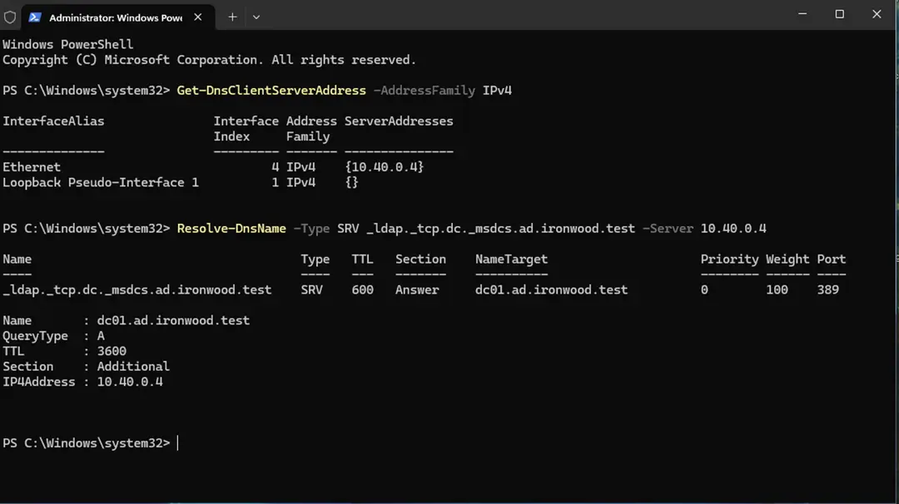
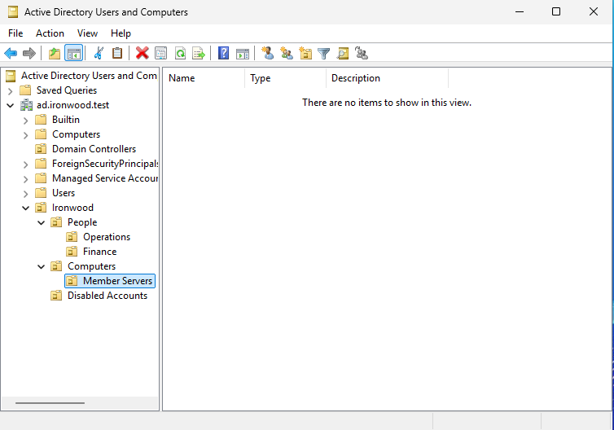
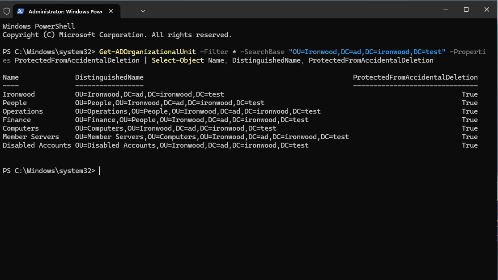
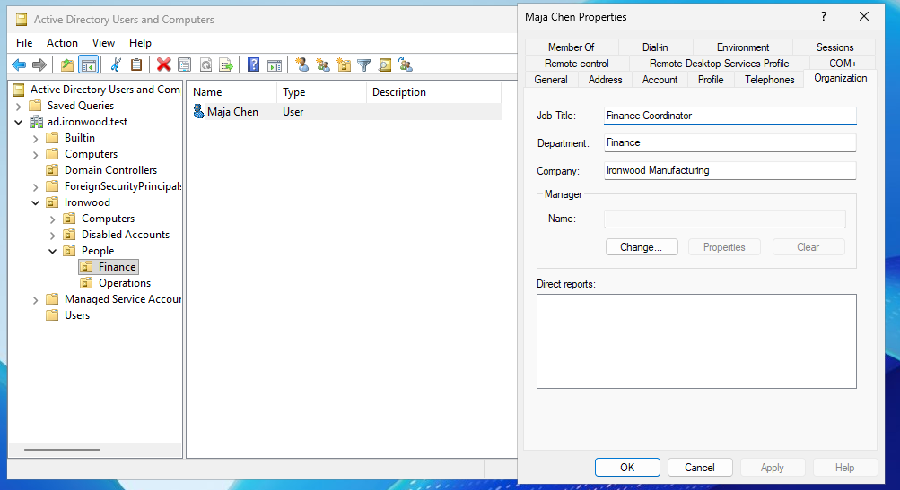
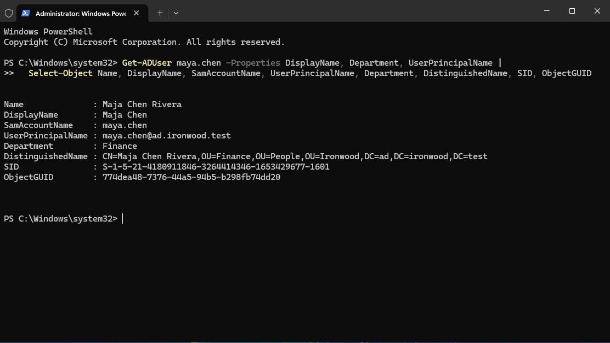

## Role installation and domain creation

- Created a domain account on DC01 (domain name: ad.ironwood.test;
short:IRONWOOD)
- Joined MEMBER01 to domain ad.ironwood.test
    - used DC01's private address as the only DNS server adress for MEMBER01
    - checked DNS server of MEMBER01 `Get-DnsClientServerAddress -AddressFamily
    IPv4` and checked domain owner `Resolve-DnsName -Type SRV
    _ldap._tcp.dc._msdcs.ad.ironwood.test -Server 10.40.0.4`

## Creation of Organizational Units

- Command for listing the OUs in Windows Powershell: `Get-ADOrganizationalUnit
-Filter * -SearchBase "OU=Ironwood,DC=ad,DC=ironwood,DC=test" -Properties
ProtectedFromAccidentalDeletion | Select-Object Name, DistinguishedName,
ProtectedFromAccidentalDeletion`

- All OUs deletion protected

## Creation of Account Maja

- Created user Maja Chen in Operations OU

- Added organizational details for Maja Chen

- Checked user details of maya.chen `Get-ADUser maya.chen -Properties
DisplayName, Department, UserPrincipalName, Enabled | Select-Object Name,
DisplayName, SamAccountName, UserPrincipalName, Department, Enabled,
DistinguishedName, SID, ObjectGUID`
- Important identifieres of maya.chen (SID:
S-1-5-21-4180911846-3264414346-1653429677-1601, ObjectGUID: 774dea48-7376-44a5-94b5-b298fb74dd20)

## Allowing User Maja Chen to login at Server MEMBER01

- I have added maya.chen to the remote desktop users (compmgmt.msc >
system.tools > local users and groups > groups > rdp) in order for her to be
able to login to the server MEMBER01

- Logged into Server MEMBER01 with maya.chen's credentials (Username:
IRONWOOD\maya.chen; Password)
- Checked if account details are correct: `whoami`, `hostname`, `whoami /user`,
  `whoami /groups`
    - `whoami /user` SID identical to the one mentioned earlier: Identification
      of user maya.chen successful

## Moving user Maya Chen to the OU Finance

- Moved Maya Chen to OU fiance and changed her job title to 'Finance
Coordinator' and 'Department' to Finance

- When running `Get-ADUser maya.chen -Properties DisplayName, Department, UserPrincipalName |
  Select-Object Name, DisplayName, SamAccountName, UserPrincipalName,
Department, DistinguishedName, SID, ObjectGUID` you can see, that the changes
were applied; SID and GID were not affected as intended.

- Note: Moving her folder can change which Group Policy settings reach her, and who is
allowed to administer her account. It does not touch her security groups, so
whatever she could open in Operations, she can still open now.

## Switching Maya Chen's Account off and on

- Disabled Maya Chen's Account and moved her to Ironwood > Disabled Accounts

- Reactivated her account and moved her back to Ironwood > Finance. The reason i
  didn't delete her account is that every permission she used to have points to her
hidden ID, which would have changed upon new account creation.

## Troubleshooting IRONWOOD\maya.chen: login issue, missing in OU:Finance

- Problem occured upon signup as user maya.chen
- Investigation using:
`Get-ADUser maya.chen -Properties Enabled, LockedOut, Department |
>>   Select-Object SamAccountName, Enabled, LockedOut, Department,
>>   DistinguishedName, SID`

- The picture shows
(1) why we can't login as maya.chen -> Enabled: false
(2) why she disappeared from Finance -> DistinguishedNames: OU=Operations
(3) that the SID stayed the same: SID:S-1-5-21-4180911846-3264414346-1653429677-1601

- In order to fix the issues we have to
(1) enable Maya Chen's account
(2) Move her from OU=Operations -> OU=Finance

- Maya was missing from Finance because her address showed she was actually in
Operations. The sign-in was refused because the account was switched off. I
moved it back and switched it on, confirmed the SID had not changed, then signed
in as her to be sure. I did not reset her password because nothing suggested the
password was wrong.

